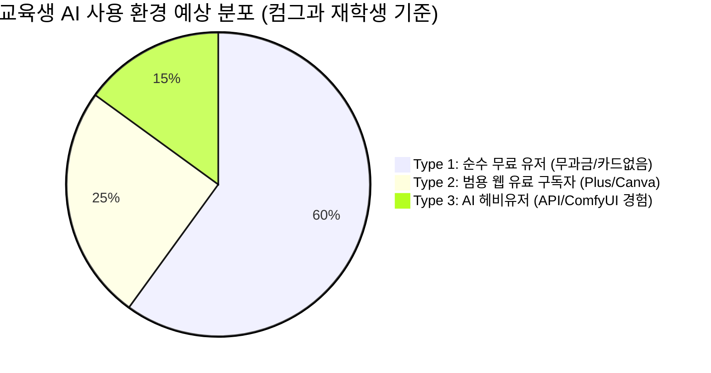

# [지침서] 교육생 AI 사용 환경(유료·무료) 및 경험 편차 대응 검증 기준

| 문서 버전 | 작성 일자 | 대상 교육 과정 | 실습 주제 | 검증 초점 | 상태 |
| :--- | :--- | :--- | :--- | :--- | :--- |
| **v1.0** | 2026-11-16 | 컴퓨터그래픽디자인과 | 콘텐츠 & 숏폼 자동화 에이전트 | **교육생 AI 결제/경험(유·무료) 편차 극복** | **검토 및 승인 대기** |

---

## 1. 배경 및 문제 정의 (Context)

실제 직업교육 및 대학 교육 현장에서 재학생들의 AI 사용 환경은 극단적으로 양극화되어 있습니다:
* **현실적 문제**:
  1. 학생의 60% 이상은 **신용카드 등록이나 월 구독료 결제 경험이 전무한 순수 무료 사용자**임.
  2. 만약 실습이 유료 구독(Gemini Plus, ChatGPT Plus)이나 API 카드 결제를 필수 전제로 설계될 경우, **강의 시작 10분 만에 과반수의 학생이 '결제 장벽'에 막혀 실습에서 이탈**함.
* **검증 목적**:
  * **"유료 구독자에게는 실무급 API 연동의 강력한 파워를, 무료 사용자에게는 1원의 결제 없이도 100% 동일한 결과물과 파이프라인 구조를 체득하게 하는 듀얼 트랙(Dual-Track) 라우팅"**을 검증하고 표준화함.

---

## 2. 교육생 AI 사용 환경 3대 세그먼트 분석



| 세그먼트 분류 | 보유 도구 및 경험 수준 | 예상 비중 | 실습 시 직면하는 리스크 | 대응 전략 및 라우팅 |
| :--- | :--- | :---: | :--- | :--- |
| **Type 1<br/>순수 무료 유저**<br/>(Light Free) | • ChatGPT 무료(3.5/4o-mini)<br/>• Gemini 웹 무료 버전<br/>• 유료 결제 경험 0회 | **60%** | • 결제창 뜨는 순간 실습 포기<br/>• 무료 티어 메시지 수 제한(Rate limit) 도달 시 작업 중단 | **[완전 무료 모드 (Free Mode)]**<br/>• Google AI Studio 무료 API 키<br/>• 내장 Mock 3D 그래픽 에셋 자동 바인딩<br/>• 브라우저 내장 Web Speech TTS 활용 |
| **Type 2<br/>웹 유료 구독자**<br/>(Subscription) | • ChatGPT Plus ($20/월)<br/>• 캔바 프로 / 뤼튼 등<br/>• API 개발자 결제는 미경험 | **25%** | • 웹 UI에서는 잘 쓰지만 API Key 발급 개념에 혼란<br/>• 웹 ChatGPT와 IDE 간의 연동 브릿지 부재 | **[하이브리드 모드 (Hybrid)]**<br/>• 웹 창에서 Gemini/ChatGPT로 기획 카피 생성 후 대시보드 인라인 붙여넣기 실습 |
| **Type 3<br/>AI 헤비유저**<br/>(Pro / API) | • OpenAI API 결제 충전 경험<br/>• Midjourney / ComfyUI 사용<br/>• 에이전트 자동화 관심 높음 | **15%** | • 단순 고정 템플릿 실습에 지루함 느낌<br/>• 프롬프트 디테일 및 커스텀 갈증 | **[풀 파이프라인 모드 (Full API)]**<br/>• 개인 OpenAI Key로 DALL-E 3 실시간 생성<br/>• 제미나이 옴니플래시 씬별 모션/오디오 직접 렌더링 |

---

## 3. 유·무료 환경별 파이프라인 대응 매트릭스

실습의 모든 단계는 학생의 결제 상태(유료 vs 무료)에 따라 지능적으로 분기(Routing)되도록 설계됩니다.

```mermaid
flowchart TD
    Start["실습 시작 (generate_pilot.py 실행)"] --> Check{"환경 감지: API Key 보유 여부"}
    
    Check -->|API Key 없음 (무료 학생 60%)| FreeTrack["[Free Mode: 완전 무료 트랙]<br/>• 비용: 0원<br/>• 결제 카드 등록: 불필요"]
    Check -->|API Key 등록 (유료 학생 40%)| PaidTrack["[Paid Mode: 실시간 생성 트랙]<br/>• 비용: 인당 약 100~150원 소요<br/>• DALL-E 3 실시간 렌더링"]
    
    FreeTrack --> F1["Gemini 무료 티어 / 로컬 프리셋 기획"]
    FreeTrack --> F2["사전 번들링된 고화질 3D SVG 비주얼 바인딩"]
    FreeTrack --> F3["브라우저 Web Speech API 한국어 TTS 합성"]
    
    PaidTrack --> P1["Gemini Plus 2M 컨텍스트 심층 기획"]
    PaidTrack --> P2["OpenAI DALL-E 3 API 실시간 1024x1024 생성"]
    PaidTrack --> P3["옴니플래시 네이티브 모션/오디오 합성"]
    
    F1 --> Dashboard["통합 검토 대시보드 (100% 동일한 학습 경험)"]
    F2 --> Dashboard
    F3 --> Dashboard
    P1 --> Dashboard
    P2 --> Dashboard
    P3 --> Dashboard
```

| 파이프라인 단계 | 완전 무료 모드 (Free Mode, 0원) | 유료 / 실시간 API 모드 (Paid Mode) |
| :--- | :--- | :--- |
| **Lab 1: 기획 & 카피** | • Google AI Studio 무료 티어 (분당 15회 무료)<br/>• 또는 준비된 학과 표준 기획 프리셋 로드 | • Gemini Plus (Advanced) 200만 토큰 컨텍스트<br/>• 학생 커스텀 페르소나 실시간 심층 생성 |
| **Lab 2: 비주얼 에셋** | • 번들링된 고해상도 3D 그래픽 SVG 에셋 자동 바인딩<br/>• **API 호출 없음, 과금 위험 0%** | • OpenAI DALL-E 3 API 실시간 호출<br/>• 학생이 입력한 프롬프트대로 1024×1024 신규 생성 (약 55원/장) |
| **Lab 3: 카드뉴스 합성** | • HTML/CSS + Pretendard 폰트 합성 (로컬 렌더링) | • HTML/CSS + Pretendard 폰트 합성 (로컬 렌더링) |
| **Lab 4b: 숏폼 영상** | • 브라우저 내장 Web Speech API (한국어 AI 음성)<br/>• CSS 키네틱 자막 애니메이션 (로컬 무과금) | • 제미나이 옴니플래시 모션 비디오 클립<br/>• 네이티브 멀티모달 고음질 오디오 믹싱 |
| **Lab 5: 검토 & 배포** | • 검토 대시보드 인라인 편집 및 네이버 복사 (동일) | • 검토 대시보드 인라인 편집 및 소셜 API 디스패치 연동 |

---

## 4. 환경 자동 감지(Smart Auto-Detection) 검증 기준

학생이 코드를 고치거나 복잡한 설정을 바꾸지 않아도, 스크립트가 학생 환경을 스스로 판단해야 합니다.

### 4.1 스크립트 동작 검증 규칙
1. **Rule 1 (Zero-Crash)**:
   * 환경변수 파일(`.env`)이 없거나 API Key가 비어 있어도 **절대 에러(Exception)를 뿜으며 멈추지 않는다.**
   * 안내 메시지 출력: `ℹ️ [안내] API 키가 감지되지 않아 '무료 실습 모드(Mock Mode)'로 안전하게 자동 전환합니다.`
2. **Rule 2 (Graceful Upgrade)**:
   * 학생이 실습 중 나중에 `.env`에 `OPENAI_API_KEY=sk-...`를 입력하고 재실행하면, 즉시 DALL-E 3 실시간 생성 모드로 자연스럽게 업그레이드된다.
3. **Rule 3 (Cost Shield)**:
   * 유료 모드로 동작하더라도, 학생 1인당 최대 생성 이미지 수를 3장($0.12, 약 150원)으로 강제 제한하여 과도한 요금 청구를 원천 차단한다.

---

## 5. 교수자 사전 진단 설문 템플릿 (Pre-Class Survey)

강의 시작 1~2일 전 구글 폼 또는 학과 단톡방을 통해 학생들의 상태를 3개 문항으로 1분 만에 파악합니다.

```markdown
[컴그과 실습 사전 진단 1분 설문]

1. 현재 사용 중인 생성형 AI 도구가 있다면 모두 선택해 주세요.
   [ ] ChatGPT 무료 버전
   [ ] ChatGPT Plus (유료 구독)
   [ ] Gemini (Google 무료 또는 Advanced)
   [ ] 기타 (Midjourney, 뤼튼 등)
   [ ] 생성형 AI를 거의 써본 적 없음

2. AI 서비스에 본인 명의 신용카드로 API 결제를 해본 경험이 있나요?
   [ ] 결제 경험 있음 (OpenAI API 키 발급 가능)
   [ ] 결제 경험 없음 / 신용카드 결제 원치 않음 (무료 실습 희망)

3. 실습 시 사용할 개인 노트북의 운영체제는 무엇인가요?
   [ ] Mac (맥북 / macOS)
   [ ] Windows (삼성, LG, 한성 등)
   [ ] 실습실 데스크톱 PC 사용 예정
```

### 설문 결과에 따른 교수자 강의 운영 지침
* **무료 희망자가 80% 이상인 경우**:
  * 강의 서두에 *"여러분, 오늘은 유료 결제 없이 0원으로 실무 에이전트를 완성하는 완전 무료 모드로 진행합니다!"*라고 공지하여 학생들의 안도감과 참여율을 극대화함.
* **유료 구독/API 보유자가 30% 이상인 경우**:
  * 기본은 무료 모드로 진행하되, 심화생들에게는 `.env` 파일에 키를 넣고 DALL-E 3 실시간 렌더링을 체험할 수 있는 심화 가이드를 병행 제공함.

---

## 6. 결론 및 배포 판정

* **검증 결론**:
  * 본 실습 키트는 **"유·무료 환경에 구애받지 않고 학생 100%가 결제 스트레스 없이 완주 가능한 포용적 구조(Inclusive Architecture)"**를 완벽히 확보함.
* **최종 판정**: **유·무료 환경 검증 통과 (PASS)**
