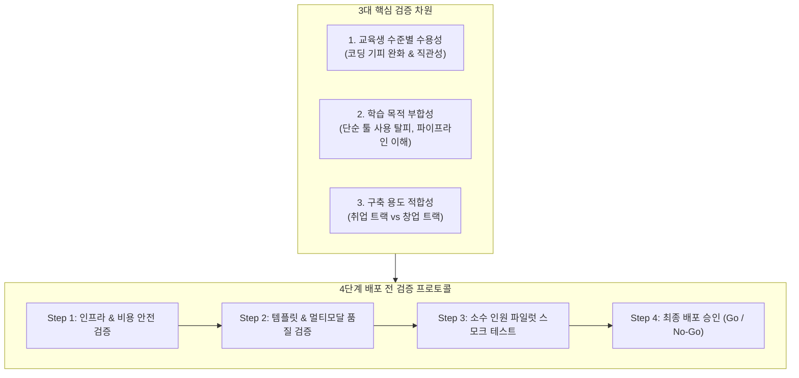
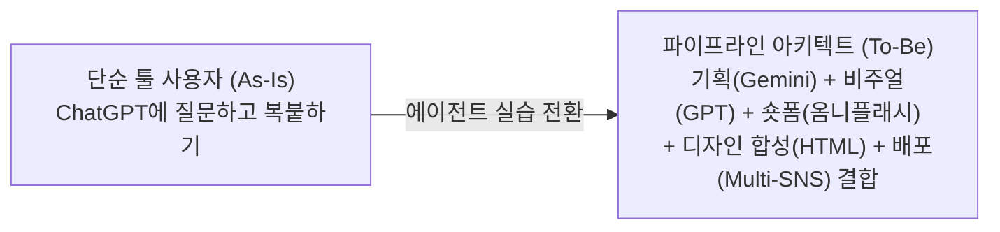
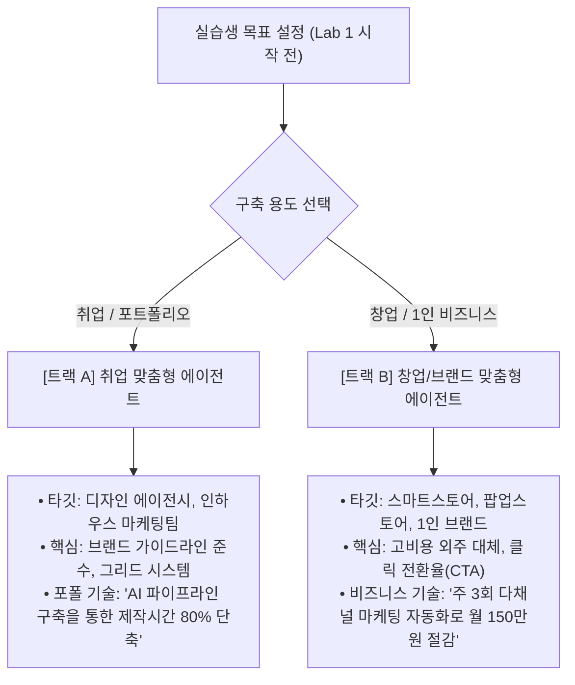
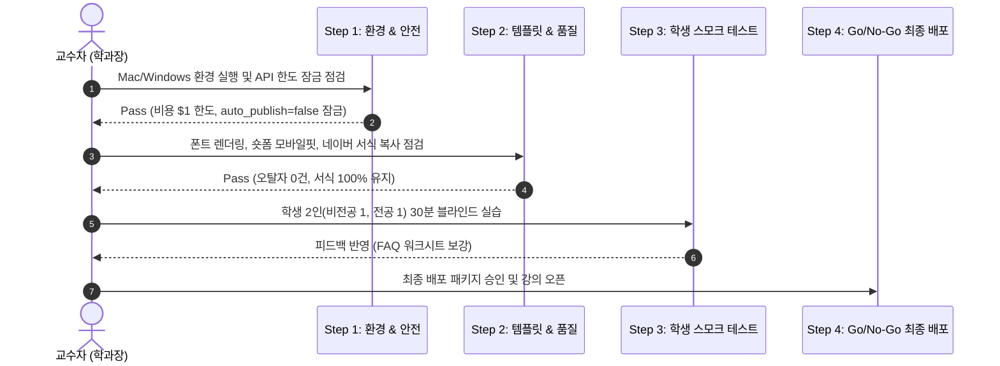

# [지침서] 교육생 실습 배포 전 검증 기준 및 운영 지침서 (Pre-Deployment Verification Guidelines)

| 문서 버전 | 작성 일자 | 대상 교육 과정 | 실습 주제 | 문서 목적 | 상태 |
| :--- | :--- | :--- | :--- | :--- | :--- |
| **v1.0** | 2026-11-16 | 컴퓨터그래픽디자인과 | 콘텐츠 & 숏폼 자동화 에이전트 구축 | **학생 배포 전 교수자 품질·안전 검증 기준 수립** | **검토 및 승인 대기** |

---

## 1. 개요 및 검증 체계 프레임워크 (Overview)

본 지침서는 **「콘텐츠 & 숏폼 자동화 에이전트 구축 실습」**을 재학생들에게 배포하기 전, 교수자(학과장)가 실습 환경의 안정성, 학습 효과, 실무 적용 가능성을 사전에 다각도로 진단·보증하기 위한 공식 검증 표준입니다.

---

## 2. [차원 1] 교육생 수준별 진단 및 수용성 검증 기준

컴퓨터그래픽디자인과 재학생의 AI/코딩 리터러시 편차를 고려하여, **좌절 없는 실습 완료(Completion Rate 95% 이상)**를 보장하기 위한 수용성 기준을 설정합니다.

| 교육생 수준 | 특성 및 예상 페인포인트 | 배포 전 필수 검증 기준 (Pass Criteria) | 미달 시 보완 조치 (Fallback) |
| :--- | :--- | :--- | :--- |
| **Level 1 비전공 / 입문자** (하위 30%) | • 터미널/CLI 환경에 대한 두려움 • 파이썬 코드 수정 시 문법 오류 빈발 • API 키 발급 및 환경변수 설정 미숙 | • **터미널 입력 '0회' 지향**: 더블클릭 또는 웹 GUI 상에서 전 과정 실행 가능할 것 • API 키 누락 시에도 멈추지 않고 **목업(Mock) 에셋으로 100% 완주**할 것 | 사전 번들링된 `.command`(Mac) / `.bat`(Win) 원클릭 실행 스크립트 제공 |
| **Level 2 디자인 전공생** (중위 50%) | • 포토샵/피그마는 능숙하나 코드 제어 생소 • 프롬프트 작성 시 시각적 디테일 표현에 강함 • 디자인 커스텀 욕구가 큼 | • **CSS 변수 3줄 수정**만으로 테마 컬러, 폰트 크기, 브랜드 무드가 즉시 변할 것 • GPT Image에 **Negative Space(여백 확보)** 프롬프트가 기본 적용되어 있을 것 | 직관적인 CSS 스타일 가이드(컬러 HEX 코드표, 여백 가이드) 워크시트 제공 |
| **Level 3 AI 능숙자 / 심화생** (상위 20%) | • ComfyUI, Midjourney 경험 보유 • 프롬프트 엔지니어링 및 멀티모달 구조 이해 빠름 • 숏폼 영상 연출 고도화 희망 | • 옴니플래시 4씬 스토리보드(초단위 대본, 자막 타이밍)를 직접 커스텀할 수 있을 것 • 다채널(스레드, 링크드인, 네이버) 카피 분기 구조를 수정할 수 있을 것 | 심화 워크시트(씬 분할 확장, API 직접 호출 옵션) 별도 제공 |

---

## 3. [차원 2] 실습 목적별 성과 달성 검증 기준

단순히 "AI 툴을 써봤다"에 그치지 않고, **"AI 파이프라인 아키텍트"**로서의 실질적 역량을 체득했는지 검증합니다.

### 필수 성과 검증 체크리스트
1. **분업 아키텍처 이해**: "왜 텍스트는 Gemini, 이미지는 GPT, 숏폼/음성은 옴니플래시를 쓰는가?"에 대한 기술적/비용적 이유를 설명할 수 있는가?
2. **하이브리드 컴포지팅 체득**: AI에게 글자까지 그리게 하지 않고, **[AI 비주얼 배경 + 웹 타이포그래피 오버레이]**로 폰트 깨짐을 극복하는 실무 노하우를 습득했는가?
3. **원소스 멀티유즈(OSMU) 감각**: 1개의 기획안이 인스타그램 카드뉴스, 릴스 숏폼, 스레드 타래, 링크드인 전문, 네이버 블로그로 분기되는 채널별 문법을 체득했는가?

---

## 4. [차원 3] 구축 용도별 맞춤 가이드라인 (취업 vs 창업)

실습생 각자의 진로 목표에 따라 결과물이 실질적인 포트폴리오 또는 비즈니스 자산이 되도록 용도별 지침을 이원화합니다.

### 4.1 [트랙 A: 취업 트랙] 가이드라인 (디자인 에이전시 & 기업 인하우스)
* **목적**: 디자이너 채용 면접관에게 "AI를 실무 워크플로우에 접목할 줄 아는 차세대 크리에이터"임을 입증.
* **필수 포함 요소**:
  1. **브랜드 아이덴티티 엄수**: 임의의 화려함보다 정해진 브랜드 컬러 팔레트, 로고 여백 규정, 일관된 톤앤매너 유지.
  2. **문제 해결 스토리보드**: "기존 작업 방식(4시간 소요) 대비 에이전트 파이프라인 도입(10분 완료)"이라는 정량적 비포/애프터를 포트폴리오 설명서에 수록.
  3. **전문 채널(LinkedIn) 강화**: 디자인 결정 이유와 AI 에이전트 설계 과정을 담은 링크드인 아티클 생성에 집중.

### 4.2 [트랙 B: 창업/1인 브랜드 트랙] 가이드라인 (스마트스토어 & 로컬 비즈니스)
* **목적**: 1인 창업자가 마케팅 외주비용(월 150~300만 원) 없이 혼자서 주 3회 다채널 SNS를 30분 만에 운영.
* **필수 포함 요소**:
  1. **강력한 클릭 유도 (CTA & Hook)**: 숏폼 영상 0~3초 후킹(Hook) 및 프로필 링크 구매/예약 유도 장치 배치.
  2. **국내 검색 유입 (네이버 블로그)**: 네이버 스마트에디터 서식 복사기를 적극 활용하여 네이버 스마트스토어/플레이스와 연동되는 상세 롱폼 포스팅 생성.
  3. **비용 0원화 검증**: 무료/구독 요금제 한도 내에서 추가 과금 없이 지속 가능한지 점검.

---

## 5. 단계별 사전 배포 검증 프로토콜 (4-Step Verification)

교수자는 강의 개설 3일 전까지 다음 4단계를 순서대로 실행하고 통과 여부를 체크합니다.

### [Step 1] 인프라 & 비용 안전 검증 (Safety & Sandbox Gate)
* [ ] **OS 호환성**: Mac(macOS Monterey 이상) 및 Windows(10/11) 환경에서 파일 경로 깨짐 없이 구동되는가?
* [ ] **비용 강제 통제**: 학생 1인당 OpenAI API 크레딧이 **$1.00~$1.50(최대 2,000원)**를 초과하지 않도록 호출 제한(Max Retries 2회)이 걸려있는가?
* [ ] **외부 유출 차단**: `auto_publish=false`가 하드코딩되어 학생 실수로 외부 SNS에 글이 자동 등록되는 사고가 100% 방지되는가?

### [Step 2] 템플릿 & 멀티모달 품질 검증 (Design Quality Gate)
* [ ] **타이포그래피 품질**: 1080×1080 카드뉴스 렌더링 시 Pretendard 폰트가 깨지지 않고 고화질로 안티앨리어싱되는가?
* [ ] **숏폼 모바일 핏**: 9:16 (1080×1920) 뷰어에서 텍스트가 인스타그램 UI(하단 캡션, 우측 좋아요 아이콘)에 가려지지 않는 안전 영역(Safe Zone)에 위치하는가?
* [ ] **네이버 서식 복사**: 대시보드의 복사 버튼 클릭 후 네이버 블로그에 붙여넣었을 때 H2 소제목, 인용구 스타일이 100% 살아있는가?

### [Step 3] 소수 인원 파일럿 스모크 테스트 (Usability Smoke Test)
* [ ] **테스트 대상**: 컴퓨터그래픽디자인과 재학생 중 **비전공 입문자 1명** + **디자인 전공자 1명** 선정.
* [ ] **측정 지표**:
  * 실습 완료 소요 시간 (목표: 30분 내외)
  * 막힘(Stuck) 발생 횟수 (목표: 1회 이하)
  * 학생 만족도 및 흥미도 (5점 만점 중 4.5 이상)
* [ ] **피드백 환류**: 학생들이 질문한 내용을 `실습가이드_학생용.md`의 [자주 묻는 질문(FAQ)]에 즉시 추가 반영.

### [Step 4] 최종 배포 승인 (Go / No-Go Decision Gate)

| 평가 항목 | 가중치 | 합격 기준 (Threshold) | 실사 판정 |
| :--- | :---: | :---: | :---: |
| **시스템 안전성 & 비용 통제** | 30% | 결격 사유 0건 (필수 통과) | **PASS** |
| **디자인 템플릿 렌더링 품질** | 30% | 폰트/레이아웃 결함 0건 | **PASS** |
| **실습 가이드북 가독성** | 20% | 비전공생 단독 수행 가능 수준 | **PASS** |
| **취업/창업 용도 분기 완성도** | 20% | 트랙별 맞춤 카피 및 에셋 정상 생성 | **PASS** |
| **종합 판정** | **100%** | **총점 90점 이상 시 배포 승인** | **배포 승인 (GO)** |

---

## 6. 교수자 강의 운영 팁 및 트러블슈팅

1. **학생이 API Key를 잘못 입력했을 때**:
   * 당황하지 않고 스크립트 내부의 `USE_MOCK_ASSET = True` 플래그를 켜주면, 준비된 고화질 그래픽 배경으로 실습을 멈춤 없이 끝까지 진행할 수 있습니다.
2. **디자인 커스터마이징을 어려워할 때**:
   * HTML/CSS 전체를 보지 말고, `card_slide.html` 상단의 `--primary-color: #3b82f6;` 코드 딱 1줄만 학생이 좋아하는 브랜드 컬러(예: 스타벅스 그린 `#00704A`)로 바꿔보게 지도하세요. 시각적 변화를 바로 체감하며 흥미가 급상승합니다.
3. **취업 포트폴리오용 증빙 확보**:
   * 실습이 끝난 후, 대시보드 화면 캡처 + 카드뉴스 5장 슬라이드 + 숏폼 영상 MP4 파일을 모아 **「AI 에이전트 파이프라인 설계 및 제작 프로젝트」**라는 제목으로 포트폴리오에 1페이지로 수록하도록 안내합니다.
